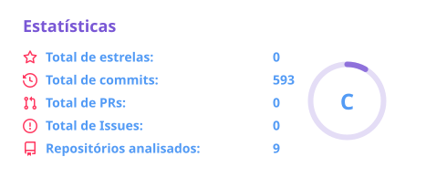
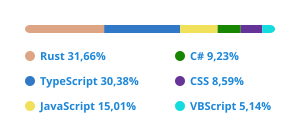

<p align="center">
  <a href="https://github.com/ylJeferson/github-animated-banner">
    
  </a>
</p>

<h1 align="center">Jeferson</h1>

---

Perfil público no GitHub com estatísticas, recursos visuais e um acervo técnico de exemplos reutilizáveis.

<p align="center">
  <a href="https://github.com/yljeferson/yljeferson/archive/refs/heads/main.zip">Download</a> |
  <a href="https://github.com/yljeferson/yljeferson/issues/new?title=Bug%3A%20">Reportar Bug</a> |
  <a href="https://github.com/yljeferson/yljeferson/issues/new?title=Ideia%3A%20">Sugerir Ideias</a>
</p>

Para apoiar o projeto com uma doação, [entre em contato pelo GitHub](https://github.com/yljeferson/yljeferson/issues).

## Funcionalidades principais

- Apresentação pessoal e links de contato.
- Cartões locais com estatísticas do GitHub e linguagens mais utilizadas.
- Recursos visuais e página 404 reutilizável.
- Exemplos e templates organizados por tecnologia.

<div align="center">
  <a href="https://github.com/yljeferson">
    
  </a>

  <a href="https://github.com/yljeferson">
    
  </a>
</div>

## Estrutura do projeto

```text
.github/workflows/update-profile-stats.yml  Atualização automática dos cartões
acervo_tecnico/                            Exemplos, referências e templates
assets/                                   Imagens, cartões SVG e página 404
scripts/generate_profile_stats.py          Consulta à API e geração dos cartões
guideline.md                              Responsabilidades e diretrizes locais
readme.md                                 Apresentação e documentação do projeto
```

A divisão entre os chats `readme`, `assets` e `acervo_tecnico` está registrada no [guideline.md](./guideline.md).

## Instalação e execução

O perfil e os arquivos do acervo podem ser consultados diretamente no GitHub, sem instalação.
Para gerar os cartões localmente, use Git, Python 3.10 ou superior e acesso à internet. O script usa somente a biblioteca padrão.

```bash
git clone https://github.com/yljeferson/yljeferson.git
cd yljeferson
python scripts/generate_profile_stats.py --username yljeferson
```

### Estatísticas do perfil

O script consulta a API do GitHub, analisa repositórios próprios que não sejam forks e grava `assets/profile-stats.svg` e `assets/top-languages.svg`.
Os cartões do README são exibidos a partir desses arquivos versionados.

O workflow `Atualizar estatísticas do perfil` está configurado para executar diariamente às 06:17 UTC, por acionamento manual no GitHub Actions ou após alterações no gerador e no próprio workflow na `main`.
Quando há diferenças nos cartões, ele cria um commit e envia a atualização à `main`, usando a permissão `contents: write`.

- `PROFILE_USERNAME`: usuário consultado; no workflow, recebe o proprietário do repositório. A opção `--username` permite defini-lo localmente.
- `PUBLIC_API_TOKEN`: token opcional para as consultas públicas; no workflow, usa o token automático do GitHub Actions.
- `PROFILE_STATS_TOKEN`: token opcional, configurado como secret no GitHub Actions, para incluir repositórios privados do próprio usuário. Se estiver ausente, inválido ou pertencer a outra conta, o script utiliza somente dados públicos.

Com acesso aos repositórios privados, seus totais agregados podem aparecer nos SVGs públicos. O conteúdo dos tokens não é gravado nos cartões.
O banner e os selos sociais continuam dependendo de serviços externos.

### Página 404

`assets/404.html` é a cópia distribuída de `acervo_tecnico/HTML/Template - 404 Celestial.html`.
O arquivo `assets/_headers` contém os cabeçalhos de distribuição; a relação entre template e cópia está documentada no `guideline.md`.

## Tecnologias utilizadas

- Markdown, HTML, CSS e SVG para apresentação e recursos visuais.
- Python e API do GitHub para gerar estatísticas.
- GitHub Actions para atualização automática.
- Batchfile, CSS, HTML, Python, TSQL e VBScript nos exemplos do acervo.

## Licença

Este repositório não contém um arquivo de licença.

## Autor

Sempre em busca do conhecimento, desvendando os mistérios da tecnologia e transformando desafios em soluções digitais.

[](https://github.com/yljeferson)
[](https://www.instagram.com/ylirej/)


- 📚 Estudante autodidata de programação e entusiasta de conhecimentos intrigantes
- 🎓 Técnico de Informática em [Etec Joaquim Ferreira do Amaral](http://www.etecjau.com.br/etecjau/)
- 💼 Assistente de TI em [Kazzo Confecções e Comércio de Artigos do Vestuário LTDA](https://pt-br.facebook.com/kazzojeans/)
- ❤️ Solteiro como um código livre, pronto para novas colaborações.
- 💬 Tem alguma pergunta? Fale comigo [aqui](https://github.com/yljeferson/yljeferson/issues)

<!-- Área de comentários -----------------------------------------
  
  &border_color=30363d - Dark Mode
  &border_color=d0d7de - Light Mode

  1d87da - azul fortin
  539bf5 - azul clarin
  ff3860 - rosinha choquinho
  7957d5 - roxin fortin
  bf91f3 - roxin clarin

 -->
